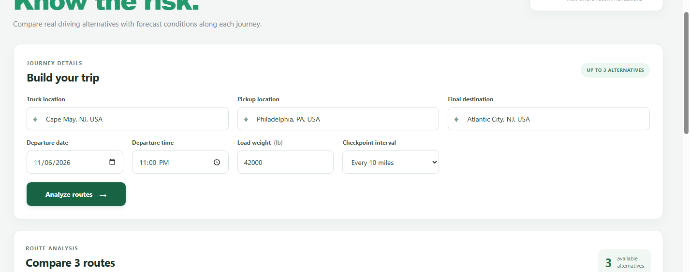
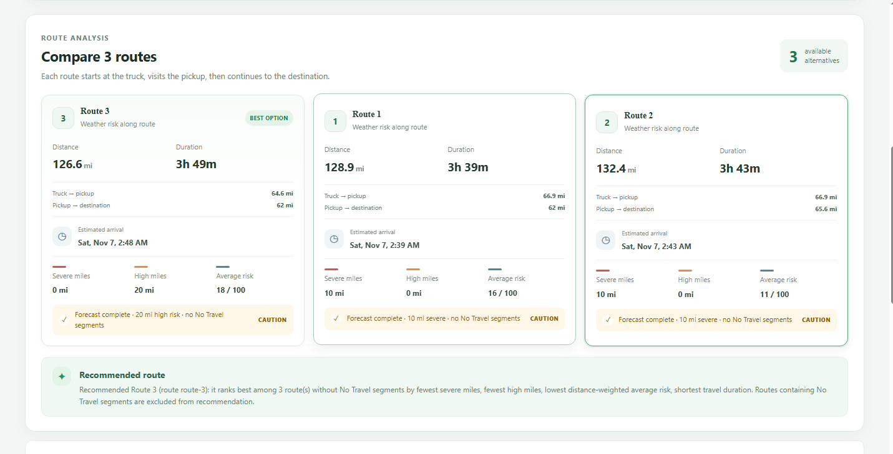
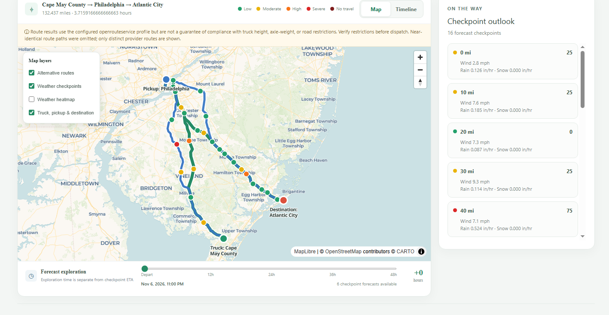
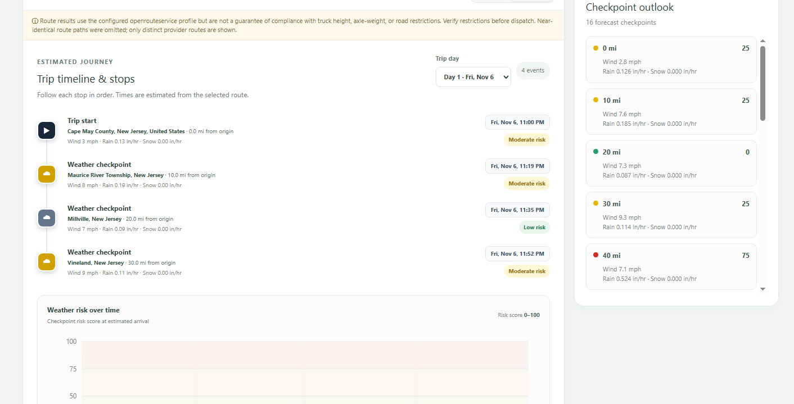
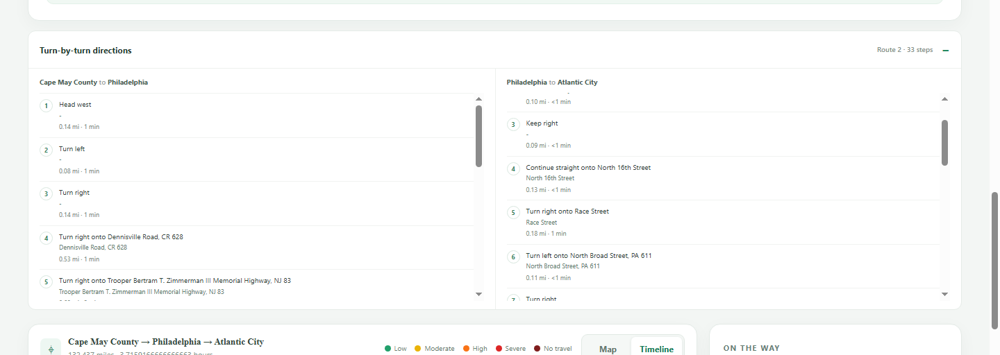
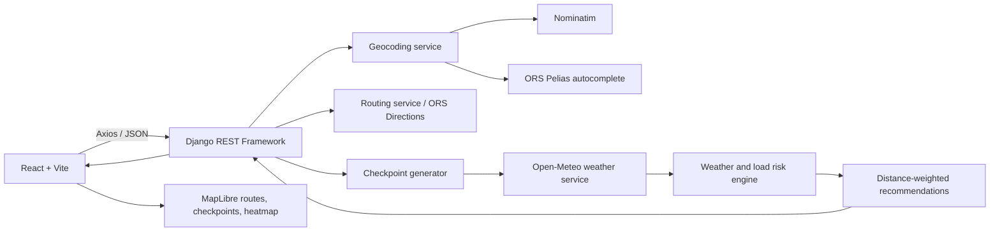

# WeatherRoute — Weather-Aware Truck Routing

WeatherRoute helps freight planners compare real road-route options with weather forecasts at estimated checkpoint arrival times. Plan a three-stop journey—truck location → pickup → destination—then review route exposure, load-aware risk, and a time-based map forecast.

> **For planning support only.** A configured HGV routing profile does not guarantee compliance with vehicle height, axle-weight, road, seasonal, hazmat, or other restrictions. Verify official restrictions and advisories before dispatch. Forecasts and ETAs are estimates, not driver logs or Hours of Service calculations.

## Product tour

The following screenshots show one Cape May County → Philadelphia → Atlantic City planning session. The route cards and weather values are a forecast snapshot; forecasts can change, and the pictured example demonstrates elevated risk rather than guaranteeing a No Travel classification.

### 1. Enter the truck, pickup, and destination



Enter a truck's current location, the freight pickup, and the final destination. Set departure date and time, load in pounds, and checkpoints every 10, 25, or 50 miles.

### 2. Compare distinct route alternatives



The recommendation ranks routes by severe miles, high miles, average risk, then duration. In this snapshot, route 3 has no severe miles and is recommended despite having 20 high-risk miles. A CAUTION label indicates elevated risk even when there are no No Travel segments.

### 3. Inspect route geometry and weather checkpoints



Review route alternatives, the pickup and endpoints, risk-colored checkpoints, map layer controls, and forecast slider. The slider changes exploratory forecast display; it does not rewrite trip checkpoint ETAs.

### 4. Follow the estimated timeline



The timeline shows departure and weather checkpoints with estimated local times and weather. Place names are reverse-geocoded when available; coordinates are the fallback when a nearby label is unavailable.

### 5. Review turn-by-turn directions



Directions are grouped into the truck-to-pickup and pickup-to-destination legs and use the routing provider's maneuver instructions.

## What it does

- Geocodes truck, pickup, and destination locations.
- Requests up to three alternatives from openrouteservice (ORS), preserving only routes actually returned by the provider.
- Builds 10/25/50-mile checkpoints along cumulative route distance with coordinate interpolation and estimated arrival times.
- Retrieves Open-Meteo hourly wind, rain, and snow for checkpoint coordinates and ETAs, with conversions to mph and inches/hour.
- Applies the assessment weather thresholds and load overrides; unknown weather stays unknown.
- Calculates severe/high exposure miles from actual route segment distances and ranks routes by severe miles, high miles, average risk, then duration.
- Shows route cards, route directions, a MapLibre map, risk-colored checkpoints, popups, a 0–48-hour weather heatmap, and an estimated route timeline.
- Handles incomplete forecasts, provider failures, repeated submissions, loading, and validation states.

### Route alternatives are provider-limited

ORS alternatives are limited by the provider (including a 100 km limit for alternative-route calculations). Longer trips may return only one route. If ORS returns one or two alternatives, WeatherRoute shows one or two; it does not invent more. Alternative availability can also depend on provider coverage, route complexity, profile, API limits, and key permissions.

## Architecture



### Repository layout

```text
backend/
  apps/                 Django domain apps: routing, geocoding, weather,
                        checkpoints, risk_engine, recommendations
  config/               Settings, URL routing, WSGI/ASGI
  services/              Shared HTTP/provider/exception utilities
  tests/                 Backend tests and fixtures
  manage.py
frontend/
  src/                  React app, journey form, route cards, map and timeline
  tests/                Vitest and React Testing Library
  e2e/                  Playwright browser tests
docs/screenshots/       README product screenshots
render.yaml             Optional Render backend blueprint
```

The React client submits three locations and journey options to the DRF planning API. Backend orchestration composes separate provider clients and domain services. The browser receives normalized route GeoJSON and checkpoint data. Map coordinates follow GeoJSON order `[longitude, latitude]`; API checkpoint latitude/longitude are also available as named fields. Provider credentials remain on the backend.

## Requirements

- Windows 10/11 and PowerShell 5.1+ or PowerShell 7+
- Python 3.10+ (the deployment blueprint specifies Python 3.12.8)
- Node.js 20+ and npm
- An [openrouteservice API key](https://openrouteservice.org/dev/#/signup) for autocomplete and route requests
- Internet access for geocoding, routing, weather, and map tiles

Open-Meteo does not require an application API key. Nominatim is used for explicit geocoding; autocomplete uses ORS Pelias. Observe the [Nominatim usage policy](https://operations.osmfoundation.org/policies/nominatim/). The current geocoding and weather caches are in-memory and process-local.

## Run locally on Windows PowerShell

Run the commands from the repository root unless indicated. Use two PowerShell windows so Django and Vite can run together.

### 1. Configure the backend

```powershell
Copy-Item backend/.env.example backend/.env
notepad backend/.env
```

Set `OPENROUTESERVICE_API_KEY` in `backend/.env`. Keep this secret out of the frontend, source control, screenshots, and browser DevTools. The local example uses `DEBUG=True`; it is for local development only.

### 2. Install and run Django

```powershell
cd backend
py -3 -m venv .venv
.\.venv\Scripts\Activate.ps1
python -m pip install --upgrade pip
pip install -r requirements-dev.txt
python manage.py check
python manage.py runserver 127.0.0.1:8000
```

If PowerShell blocks virtual environment activation, allow it for this terminal only and activate again:

```powershell
Set-ExecutionPolicy -Scope Process -ExecutionPolicy Bypass
.\.venv\Scripts\Activate.ps1
```

Health endpoint: <http://127.0.0.1:8000/api/health/>.

### 3. Install and run React + Vite

In a second PowerShell window, from the repository root:

```powershell
Copy-Item frontend/.env.example frontend/.env.local
cd frontend
npm ci
npm run dev
```

Open the local URL printed by Vite, normally <http://localhost:5173/>. `VITE_API_BASE_URL` is public build-time configuration and must point to the API root ending in `/api`. Never put an API key or other secret in a `VITE_*` variable.

### Stop the local servers

Press `Ctrl+C` in each terminal running Django and Vite. The environment files stay local and can be reused next time.

## Configuration

Use the examples for each runtime: [`backend/.env.example`](backend/.env.example) and [`frontend/.env.example`](frontend/.env.example). The root [`.env.example`](.env.example) is a combined reference.

| Variable | Where | Description |
|---|---|---|
| `OPENROUTESERVICE_API_KEY` | Backend secret | Required for autocomplete and route requests. Never expose to browser code. |
| `OPENROUTESERVICE_PROFILE` | Backend | Routing profile; default is `driving-hgv`. |
| `NOMINATIM_BASE_URL` | Backend | Nominatim search endpoint. |
| `DJANGO_SECRET_KEY` | Backend secret | Django signing key; required with `DEBUG=False`. |
| `DEBUG` | Backend | Use `False` in production. |
| `ALLOWED_HOSTS` | Backend | Comma-separated Django host allowlist. |
| `CORS_ALLOWED_ORIGINS` | Backend | Comma-separated exact frontend origins, including scheme and no path. |
| `APP_VERSION` | Backend | Version string returned by `/api/health/`. |
| `LOG_LEVEL` | Backend | Python log level, usually `INFO`. |
| `VITE_API_BASE_URL` | Frontend build | API base URL ending with `/api`; local default is `http://127.0.0.1:8000/api`. |

## API overview

API paths below are relative to `/api`. The API currently does not require user authentication. Errors use JSON with an `error` and `code`, and may include validation `details`.

### `GET /api/health/`

Returns application health and version:

```json
{"status":"ok","version":"1.0.0"}
```

### `GET /api/geocode/autocomplete/?q=<text>`

Returns address suggestions from ORS Pelias. Queries shorter than three characters return no suggestions. Requires the ORS key.

```json
{"suggestions":[{"label":"Buffalo, NY, USA","longitude":-78.8784,"latitude":42.8864}]}
```

### `GET /api/geocode/?q=<text>`

Resolves a selected location using Nominatim and returns its label and coordinates.

### `POST /api/plan/`

Geocodes all three locations, requests routes through pickup, then generates checkpoints and attaches weather, risk, and recommendation results.

```json
{
  "origin": "Buffalo, NY, USA",
  "pickup": "Rochester, NY, USA",
  "destination": "Syracuse, NY, USA",
  "departure_time": "2026-11-06T20:00:00Z",
  "load_weight_tons": 21,
  "checkpoint_interval_miles": 25
}
```

`departure_time` must be ISO-8601 with `Z` or a UTC offset. The frontend accepts pounds and converts to short tons for the API (`42,000 lb = 21 tons`). Supported intervals are 10, 25, and 50 miles.

Each route response includes route ID/name, GeoJSON `LineString` geometry, distance, duration, two route legs, ETA checkpoints, risk metrics, and recommendation state. Each checkpoint has coordinates, distance/progress, estimated arrival, nullable weather values, forecast availability, and risk details. Route metrics include severe miles, high miles, average risk, No Travel segments, and forecast coverage. See [`frontend/src/contracts.js`](frontend/src/contracts.js) and [`backend/apps/routing/serializers.py`](backend/apps/routing/serializers.py) for the concrete response contract.

## Risk and recommendation rules

| Weather | Low | Moderate | High | Severe | No Travel |
|---|---:|---:|---:|---:|---:|
| Wind (mph) | `<25` | `25–<35` | `35–<45` | `45–<55` | `>=55` |
| Rain (in/hour) | `<0.10` | `0.10–<0.25` | `0.25–<0.50` | `0.50–1.00` | `>1.00` |
| Snow (in/hour) | `<0.5` | `0.5–<1.0` | `1.0–<2.0` | `2.0–3.0` | `>3.0` |

Load rules: wind `>=55 mph` is No Travel for every load; wind `45–<55 mph` with load `>30,000 lb` is No Travel; wind `35–<45 mph` with load `>40,000 lb` is at least Severe. The highest known weather or load risk determines checkpoint risk. If all weather values are unavailable, the checkpoint risk is **Unknown**, not zero.

Risk miles use actual segment distances between checkpoints. Route recommendation order is: (1) fewest severe miles, (2) fewest high miles, (3) lowest distance-weighted average risk, (4) shortest duration. No Travel routes are excluded. Incomplete forecast coverage is marked unknown/incomplete and is not called safe. If all adequately assessed options contain No Travel segments, the API returns **No safe route available**.

## Weather and time handling

Open-Meteo hourly weather is matched to each checkpoint's estimated arrival time. Source wind in km/h converts to mph (`1 km/h = 0.621371192237334 mph`); precipitation/rain in mm converts to inches (`1 mm = 1/25.4 in`); snowfall in cm converts to inches (`1 cm = 1/2.54 in`). The inches/hour display represents accumulation during the source's preceding hourly interval. Arrival datetimes are normalized to UTC for matching; missing arrays, null values, and unavailable hours remain missing. The 0–48-hour slider is an exploratory forecast time distinct from the trip's checkpoint ETAs.

## Testing and quality checks

Run the automated suites from separate terminals (or stop Vite/Django first if the E2E runner needs their ports):

```powershell
# Backend
cd backend
.\.venv\Scripts\Activate.ps1
python manage.py check
python manage.py test tests --verbosity 1
```

```powershell
# Frontend unit/component tests, browser tests, and production build
cd frontend
npm ci
npm run test
npm run test:e2e
npm run build
```

For backend coverage, install `backend/requirements-dev.txt`, then run:

```powershell
coverage run --data-file=.coverage manage.py test tests
coverage report --data-file=.coverage -m
```

For suite scope, actual run dates/counts, and live-versus-mocked details, read [`TESTING.md`](TESTING.md) and [`QA_TEST_REPORT.md`](QA_TEST_REPORT.md). Automated provider tests use mocks; they do not prove that a live provider is currently available. An optional live browser smoke (`npm run qa:live`) requires both local servers and a valid ORS key.

## Deployment status

The project source is in the private GitHub repository [MuhammadAwais1315/weather-aware-truck-routing](https://github.com/MuhammadAwais1315/weather-aware-truck-routing), branch `main`.

- **Frontend:** [https://weather-aware-truck-routing-psi.vercel.app](https://weather-aware-truck-routing-psi.vercel.app)
- **Django API health:** [https://weather-aware-truck-routing-api-kappa.vercel.app/api/health/](https://weather-aware-truck-routing-api-kappa.vercel.app/api/health/)
- The prior `weather-aware-truck-routing.vercel.app` alias is assigned to an existing deployment and did not accept reassignment during the last deployment; use the frontend URL above for the latest build.
- A live production New York–Boston journey previously returned one actual route and rendered its checkpoints/map. ORS alternatives are unavailable for that longer than 100 km request, so the UI reported one route instead of fabricating alternatives.
- [`render.yaml`](render.yaml) prepares Render as an alternative backend host; the current production API is on Vercel. Render is not claimed as a verified deployment.

### Deployment configuration

For Vercel, configure `VITE_API_BASE_URL` as a Production environment variable on the frontend project, then redeploy because Vite embeds it at build time. Set `OPENROUTESERVICE_API_KEY`, `DJANGO_SECRET_KEY`, `DEBUG=False`, host settings, and exact `CORS_ALLOWED_ORIGINS` on the backend project. Keep secrets server-side. Vercel-specific configuration is in [`frontend/vercel.json`](frontend/vercel.json) and [`backend/vercel.json`](backend/vercel.json). `render.yaml` is an optional Render Blueprint configuration.

Useful live checks:

```powershell
Invoke-RestMethod https://weather-aware-truck-routing-api-kappa.vercel.app/api/health/
Invoke-WebRequest https://weather-aware-truck-routing-psi.vercel.app/
```

A health response verifies only API liveness, not the full route/weather workflow. Provider quota/key access, browser CORS, and a live itinerary should be checked separately after configuration changes.

## Known limitations

- ORS may return fewer than three routes; its alternative calculation has distance and provider constraints.
- HGV routing does not guarantee regulatory vehicle or road restriction compliance.
- Forecast coverage is finite; unknown values remain unknown. Open-Meteo availability/horizon can change.
- Checkpoint weather requests and external provider quotas can increase planning latency, especially with 10-mile spacing on long trips.
- Geocoding and forecast caching is process-local, in-memory, non-persistent, and not shared across workers.
- The risk engine is a fixed threshold model; it does not model traffic, road surface, closures, vehicle dimensions, or driver-specific guidance.
- The map uses CARTO Voyager tiles and OpenStreetMap data/attribution; availability and usage are subject to their terms.
- No accounts, authentication, persistent trip storage, or application-level rate limiting are implemented.
- The production JavaScript bundle has previously emitted a size advisory; consider lazy-loading MapLibre and splitting bundles if optimizing for scale.

## Demo walkthrough

See [`LOOM_WALKTHROUGH.md`](LOOM_WALKTHROUGH.md) for the 5–10 minute narrated demo, on-screen actions, suggested risk scenarios, and presenter checklist.

## License

No open-source license is currently declared. Use and redistribution are subject to the repository owner's terms unless a license is added.
