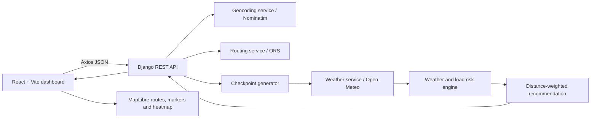

# Weather-Aware Truck Routing

WeatherRoute is a responsive React dashboard backed by Django REST Framework. It accepts a freight journey, requests real alternatives from openrouteservice, creates checkpoints along the returned route geometry, matches Open-Meteo hourly forecasts to checkpoint ETAs, scores weather/load risk, and ranks safe alternatives. MapLibre displays returned routes, risk-colored checkpoints and an exploratory 0–48-hour weather heatmap.

> **Assessment/safety note:** This is a planning aid. A configured `driving-hgv` profile does not guarantee that a route satisfies every truck height, axle-weight, hazmat, seasonal, or road restriction. Verify official restrictions and advisories before dispatch.

## Features

- Origin/destination autocomplete, departure date/time, load weight in pounds, and 10/25/50-mile checkpoint interval.
- Up to three **provider-returned** ORS driving alternatives. The application never fabricates missing alternatives.
- Nominatim forward geocoding and ORS Pelias autocomplete.
- Distance-based checkpoints on actual route geometry, including origin and destination; cumulative-distance interpolation and segment duration ETAs when the provider supplies them.
- Hourly weather matched to each checkpoint ETA. Values are normalized to wind mph and rain/snow inches per hour. Missing forecast values remain unknown.
- Central weather bands and load overrides, distance-weighted severe/high miles, and recommendation ordering: severe miles, high miles, average risk, then duration. Routes with No Travel segments are not eligible for recommendation.
- Interactive MapLibre routes, endpoint markers, checkpoint popups/layers, and heatmap exploration from 0 to 48 hours after departure. Exploratory time does not change trip ETA.

## Architecture



The frontend is under `frontend/src`: `PlannerForm` owns journey inputs, `api.js` is the Axios client, `contracts.js` checks the response shape, `forecast.js` computes slider timestamps and checkpoint GeoJSON, and `MapView` owns one MapLibre map instance and updates its sources. The backend is under `backend`: `apps/routing` validates requests and orchestrates planning, while `geocoding`, `checkpoints`, `weather`, `risk_engine` and `recommendations` keep domain logic isolated. `services` contains shared HTTP, route-provider and DRF exception handling. Provider credentials are only read by the backend.

## Requirements

- Windows 10/11 with PowerShell 5.1+ or PowerShell 7+
- Python 3.10+ (Render blueprint currently pins 3.12.8)
- Node.js 20+ and npm
- Internet access for provider APIs and CARTO Voyager basemap tiles
- An [openrouteservice API key](https://openrouteservice.org/dev/#/signup) for autocomplete and directions

Open-Meteo requires no application API key. Nominatim is used only for explicit geocoding, not autocomplete; observe the [Nominatim usage policy](https://operations.osmfoundation.org/policies/nominatim/). The local geocoder throttles and caches requests in-process. Forecast/geocoding caches are in-memory, per process, and are lost at restart.

## Install and run on Windows PowerShell

Run commands from the repository root unless noted. Keep the backend and frontend in separate PowerShell windows.

### 1. Configure the backend

```powershell
Copy-Item backend/.env.example backend/.env
notepad backend/.env
```

Put your ORS key in `OPENROUTESERVICE_API_KEY`. Keep `backend/.env` private; `.env` files are git-ignored. The local sample enables `DEBUG=True` and uses local-only hosts/origins. Never use those settings for production.

### 2. Install and start Django

```powershell
cd backend
py -3 -m venv .venv
.\.venv\Scripts\Activate.ps1
python -m pip install --upgrade pip
pip install -r requirements-dev.txt
python manage.py check
python manage.py test tests
python manage.py runserver 127.0.0.1:8000
```

If activation is blocked for this PowerShell process, run `Set-ExecutionPolicy -Scope Process -ExecutionPolicy Bypass`, then activate again. Health check: <http://127.0.0.1:8000/api/health/>.

### 3. Configure and start Vite

In a second PowerShell window, from the repository root:

```powershell
Copy-Item frontend/.env.example frontend/.env.local
cd frontend
npm ci
npm run dev
```

Open the Vite URL printed in the terminal (normally <http://localhost:5173/>). `VITE_API_BASE_URL` is compiled into the browser bundle; it must be a public HTTPS API URL in production and must not contain a secret.

### 4. Build and run tests

```powershell
cd frontend
npm run test
npm run test:e2e
npm run test:all
npm run build
```

For test scope, latest counts, measured backend coverage, limitations, and follow-up, see [TESTING.md](TESTING.md). For a live browser smoke against an already-running local API and Vite instance:

```powershell
npm run qa:live
```

The live smoke needs a configured ORS key. Provider-dependent automated tests mock external responses. See [QA_TEST_REPORT.md](QA_TEST_REPORT.md) for the latest executed results, their mocked/live boundary, and known build/runtime warnings. Backend coverage tooling is listed in `backend/requirements-dev.txt`; run `coverage run manage.py test tests` followed by `coverage report -m` after installing development requirements. The frontend suite currently has no coverage provider configured, so its passing test count is not a line/branch coverage percentage.

## Environment reference

Examples are split by runtime: [`backend/.env.example`](backend/.env.example) and [`frontend/.env.example`](frontend/.env.example). The root `.env.example` is retained as a combined quick reference. Never put `OPENROUTESERVICE_API_KEY` in a `VITE_*` variable or frontend file; Vite variables are public.

| Variable | Runtime | Purpose |
|---|---|---|
| `DJANGO_SECRET_KEY` | Backend | Django signing key. Required when `DEBUG=False`; Render generates one through the blueprint. |
| `DEBUG` | Backend | Django debug mode. `False` in production. |
| `APP_VERSION` | Backend | Version returned from health endpoint. |
| `ALLOWED_HOSTS` | Backend | Comma-separated Django host allowlist; Render host is also read from `RENDER_EXTERNAL_HOSTNAME`. |
| `CORS_ALLOWED_ORIGINS` | Backend | Comma-separated exact browser origins allowed to call the API. Set the deployed Vercel origin, including `https://`, in Render. |
| `LOG_LEVEL` | Backend | Python root log level, usually `INFO`. |
| `OPENROUTESERVICE_API_KEY` | Backend | ORS Pelias autocomplete and Directions API key. Required for a complete journey. |
| `OPENROUTESERVICE_PROFILE` | Backend | Routing profile; default `driving-hgv`. |
| `NOMINATIM_BASE_URL` | Backend | Nominatim search API URL. |
| `VITE_API_BASE_URL` | Frontend build | API root ending in `/api`, e.g. `https://your-api.onrender.com/api`. Local default is `http://127.0.0.1:8000/api`. |

## API documentation

All API paths are relative to the API root (`/api`). JSON errors use `{"error":"...","code":"..."}`. Validation errors may also include a `details` object. Upstream services have bounded timeouts and are translated to gateway/service error responses; missing credentials return HTTP 503.

### `GET /api/health/`

No authentication. Returns application liveness/version:

```json
{"status":"ok","version":"1.0.0"}
```

### `GET /api/geocode/autocomplete/?q=<text>`

Requires ORS key. Queries shorter than three characters return an empty suggestions array.

```json
{"suggestions":[{"label":"New York, NY, USA","longitude":-74.006,"latitude":40.713}]}
```

Coordinates in suggestion objects are explicit `longitude` and `latitude` fields. The browser submits the selected label; the plan endpoint resolves it through Nominatim.

### `GET /api/geocode/?q=<text>`

Nominatim forward geocode; requires at least three characters.

```json
{"label":"New York, United States","latitude":40.7127281,"longitude":-74.0060152}
```

### `POST /api/plan/`

Runs geocoding, route alternatives, checkpoints, weather-at-ETA, risk and recommendation. Departure time must be ISO-8601 with `Z` or explicit UTC offset. Load is in **short tons at the API boundary**; the browser accepts pounds and divides by 2,000. Supported interval values are integer miles 10, 25 or 50.

Request:

```json
{
  "origin":"New York, NY",
  "destination":"Chicago, IL",
  "departure_time":"2026-11-03T14:00:00Z",
  "load_weight_tons":21,
  "checkpoint_interval_miles":25
}
```

Response top-level fields include `origin`, `destination`, `departure_time`, `load_weight_tons`, `checkpoint_interval_miles`, `routes`, `recommendation`, `recommended_route_id`, `ranked_routes`, `route_summaries`, `ranking_explanation` and `routing_notice`.

Each route includes `id`, `name`, GeoJSON `geometry` (`LineString`, coordinate order `[longitude, latitude]`), `distance_miles`, `duration_hours`, provider summary, `checkpoints`, `metrics`, and `recommended`. A checkpoint includes `id`, `latitude`, `longitude`, `coordinates`, `distance_from_origin_miles`, `distance_to_next_checkpoint_miles`, `progress_percent`, timezone-aware `estimated_arrival_time`, `weather`, and `risk`. Weather reports `available`, `forecast_time`, requested/matched time, nullable values (`wind_speed_mph`, `rain_inches_per_hour`, `snowfall_inches_per_hour`) and `units`. Risk includes component risks, `risk_label`, `final_risk_score`, `load_override`, and `explanation`. Route metrics include severe/high miles, distance-weighted average risk and No Travel segments. See `frontend/src/contracts.js` and the mocked API fixtures in `frontend/tests/fixtures.js` for the runtime response contract.

## Assessment rules implemented

- Wind (mph): `<25` Low; `25–<35` Moderate; `35–<45` High; `45–<55` Severe; `>=55` No Travel.
- Rain (inches/hour): `<0.10` Low; `0.10–<0.25` Moderate; `0.25–<0.50` High; `0.50–1.00` Severe; `>1.00` No Travel.
- Snow (inches/hour): `<0.5` Low; `0.5–<1.0` Moderate; `1.0–<2.0` High; `2.0–3.0` Severe; `>3.0` No Travel.
- Load rules: wind `>=55 mph` is No Travel for every load; wind `45–54 mph` with load `>30,000 lb` is No Travel; wind `35–44 mph` with load `>40,000 lb` is at least Severe.
- The checkpoint final risk is the highest of known weather-component risks and any applied load override. If every weather component is missing, risk is `Unknown`/null, not Low.
- Segment risk applies over the distance from one checkpoint to the next. The last destination point contributes no extra miles. Recommendation priorities are severe miles, high miles, average risk, and travel duration. A route with any No Travel segment cannot be recommended; if every route is unsafe the recommended route ID is null and the explanation is `No safe route available`.

## Deployment preparation

The project is pushed to the private [GitHub repository](https://github.com/MuhammadAwais1315/weather-aware-truck-routing) on `main`. Both the [React frontend](https://weather-aware-truck-routing-psi.vercel.app/) and [Django API](https://weather-aware-truck-routing-api-kappa.vercel.app/api/health/) are deployed to Vercel. The OpenRouteService production key is configured as a Vercel secret. A real New York-to-Boston journey completed in the public dashboard: the API returned one provider route, six ETA-based checkpoints with weather, a recommendation, route geometry and the map rendered without browser console or HTTP errors. The trip exceeds openrouteservice's 100 km alternative-route limit, so its API returned only one actual route; the application explains this limit and does not fabricate alternatives.

### Render backend (alternative)

The root [`render.yaml`](render.yaml) defines a Python web service rooted at `backend/`, installs requirements, applies Django migrations at start, serves WSGI with Gunicorn, and exposes `/api/health/` as the health check. In Render, create a Blueprint from the connected repository. Set the prompted `OPENROUTESERVICE_API_KEY` and `CORS_ALLOWED_ORIGINS` values in Render. Once Vercel provides its production domain, set `CORS_ALLOWED_ORIGINS=https://<your-vercel-domain>` (exact origin, no path or trailing slash), save and deploy. Render supplies `RENDER_EXTERNAL_HOSTNAME`; settings add that service host to Django's host allowlist. Keep `DEBUG=false` and do not paste secrets into `render.yaml`.

The app currently has no user/account or durable business data, so no production database is required for the current feature set. Django's installed built-in auth/contenttypes migrations are run by the Render start command. Per-process geocoding/weather caches are ephemeral and not shared between workers.

### Vercel backend

The Vercel API project `weather-aware-truck-routing-api` is rooted at `backend/`, where [`backend/vercel.json`](backend/vercel.json) sets a 180-second function duration and excludes test/cache files. Vercel detects Django from `manage.py`, and Python 3.12 is declared in `backend/.python-version`. Production has `DEBUG=False`, a generated secret, an exact CORS allow-origin for the frontend, and `OPENROUTESERVICE_API_KEY` set as a secret. The runtime derives its deployment host from Vercel system variables. The deployed API health check returns `{"status":"ok","version":"1.0.0"}`. The local `render.yaml` remains an alternative backend host configuration.

### Vercel frontend

The Vercel frontend project `weather-aware-truck-routing` is rooted at `frontend`; [`frontend/vercel.json`](frontend/vercel.json) provides SPA fallback. Its Production environment now includes `VITE_API_BASE_URL=https://weather-aware-truck-routing-api-kappa.vercel.app/api`; Vite embeds this public API URL at build time. Variables beginning `VITE_` are public configuration; never place provider keys there. The production frontend origin is allowed in backend CORS. Deployments were made via CLI; GitHub automatic deployments are not configured.

### Production verification checklist

Production health, CORS, and a complete browser journey have been verified. A New York-to-Boston production request returned one actual route (the trip is over the provider's 100 km alternatives limit), 6/6 checkpoints with weather, recommendation `route-1`, and a rendered MapLibre canvas. The MapLibre worker loads from a Vite-emitted asset and the browser check reported no console or HTTP errors. Recheck the public API and UI with:

```powershell
Invoke-RestMethod https://weather-aware-truck-routing-api-kappa.vercel.app/api/health/
Invoke-WebRequest https://weather-aware-truck-routing-psi.vercel.app/
```

The current live browser verification used interval 50; intervals 10, 25 and 50 are covered by backend and frontend automated tests. The Playwright UI suite covers route rendering, checkpoints/popups, forecast slider changes, loading/errors, repeat submissions and responsive widths. For further live checks, inspect ORS geometry/count, checkpoint ETA/weather, route layers, popups and heatmap at several forecast offsets; test missing forecasts and unavailable routes. A successful health check alone does not verify the workflow.

Deployment format follows [Vercel's Django guide](https://vercel.com/docs/frameworks/full-stack/django), [Vercel Vite guidance](https://vercel.com/docs/frameworks/frontend/vite), and the [Render Django deployment guide](https://render.com/docs/deploy-django). See also [Render Blueprint environment variables](https://render.com/docs/blueprint-spec) and [Vercel environment variables](https://vercel.com/docs/environment-variables).

## Known limitations and risks

- Real ORS routes and alternatives require an active key, quota and provider availability. ORS alternative-route calculations are limited to trips under 100 km; for longer trips the backend retries once without the alternatives option and returns only the provider's actual route, with an explanatory notice. It does not fabricate alternatives.
- HGV profile results are not regulatory clearance; height, axle, weight and road restrictions can be incomplete or missing.
- Open-Meteo horizon is limited (the service requests seven forecast days). Forecasts beyond available hourly data are reported unavailable; no weather is invented. The 0–48h slider only visualizes forecast observations within its matching window.
- The planner fetches weather per checkpoint sequentially. A long route at a 10-mile spacing can create many upstream calls and a long request. Provider quotas, rate limiting and deployment request-duration limits apply.
- In-memory caches are process-local, non-persistent and duplicated across Gunicorn workers. Nominatim's request serialization is also local to one worker.
- The risk model is a fixed threshold heuristic and does not incorporate official road closures, road surface, vehicle configuration, traffic or driver-specific guidance.
- The map uses CARTO Voyager vector tiles with OpenStreetMap attribution for clearer roads and place labels. Tile availability, attribution and usage remain subject to CARTO's terms; use a contracted tile service if traffic grows.
- Current Vite production build emits a large JavaScript chunk advisory. Consider lazy loading MapLibre or manual chunking before scaling.
- No browser/API authentication, rate limiting, persistent database or user accounts are implemented; protect the API with provider quotas/hosting controls if exposed to untrusted high-volume traffic.
- Frontend line/branch coverage is not measured yet. Existing frontend tests report test counts, not a code coverage percentage.

## Walkthrough script

See [LOOM_WALKTHROUGH.md](LOOM_WALKTHROUGH.md) for an 8-minute demo script mapped to the assessment checklist, including the honest fallback if provider credentials or public deployment are not ready.
